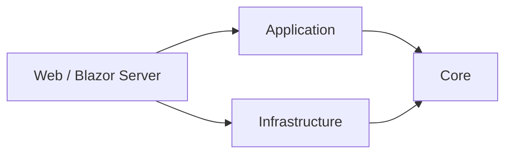

# Administrative Management System

[](https://github.com/Gutti22/administrative-management-system-dotnet/actions/workflows/dotnet-ci.yml)

A web-based administrative system built with **C#**, **.NET 8**, **Blazor Server**, **ADO.NET**, and **MySQL**.

The project manages customers, products, invoicing, reporting, and application error logs using a layered architecture with explicit separation between domain contracts, application services, infrastructure, and UI.

## Highlights

- Layered architecture inspired by Clean Architecture principles
- Customer and product management
- Transactional invoice creation
- Server-side validation of product prices and quantities
- Concurrency-safe stock updates
- Transactional invoice numbering
- SQL reporting for sales, customers, and low-stock products
- Application error logging
- Asynchronous database access with ADO.NET
- Continuous integration with GitHub Actions

## Architecture



```text
SistemaAdmin/
├── SistemaAdmin.core/             # Entities and repository contracts
├── SistemaAdmin.Application/      # Business services and DTOs
├── SistemasAdmin.Infrastructure/  # ADO.NET and MySQL repositories
├── SistemaAdmin.Web/              # Blazor Server UI
└── Scripts/                       # Database scripts
```

## Modules

| Module | Route | Description |
|---|---|---|
| Customers | `/clientes` | Create, search, edit, activate, and deactivate customers |
| Products | `/productos` | Product CRUD and stock management |
| Invoices | `/facturas` | Invoice creation with automatic 15% ISV calculation |
| Reports | `/reportes` | SQL-based sales and inventory reports |
| Error Log | `/bitacora` | Application error history |

## Tech Stack

- **Backend:** C# · .NET 8 · ADO.NET
- **UI:** Blazor Server
- **Database:** MySQL 8
- **Data access:** MySqlConnector
- **Architecture:** Core · Application · Infrastructure · Web
- **CI:** GitHub Actions
- **Development:** Visual Studio 2022 · Git

## Data Integrity

Invoice creation is executed inside a database transaction.

The workflow:

1. Generates the next invoice number using a transactional counter.
2. Inserts the invoice header.
3. Inserts every invoice line.
4. Updates product stock only when sufficient inventory is still available.
5. Commits all changes together.

If any step fails, the complete operation is rolled back.

Product names and prices are reloaded from the database before the invoice is created, so billing does not trust price values received from the UI.

## Getting Started

### Requirements

- .NET 8 SDK
- MySQL Server 8.0+
- Visual Studio 2022 or another .NET-compatible IDE

### 1. Create the database

Run:

```text
Scripts/schema.sql
```

The script creates the `SistemaAdmin` database and the required tables and indexes.

### 2. Configure the local connection string

Copy:

```text
SistemaAdmin.Web/appsettings.Local.example.json
```

to:

```text
SistemaAdmin.Web/appsettings.Local.json
```

Then replace `YOUR_PASSWORD` with your local MySQL password.

The local file is ignored by Git so credentials are not committed to the repository.

You can also provide the connection string through the `ConnectionStrings__MySql` environment variable.

### 3. Run the application

From the repository root:

```bash
dotnet restore
dotnet run --project SistemaAdmin.Web
```

Alternatively, open `Admin.sln` in Visual Studio 2022 and set `SistemaAdmin.Web` as the startup project.

## Technical Documentation

More details about architecture and design decisions are available in [DOCUMENTACION_TECNICA.md](DOCUMENTACION_TECNICA.md).

## Roadmap

- Automated unit and integration tests
- Authentication and role-based authorization
- Pagination and advanced filters
- Export reports to PDF or Excel
- Docker-based local environment
- Additional API endpoints for external integrations
